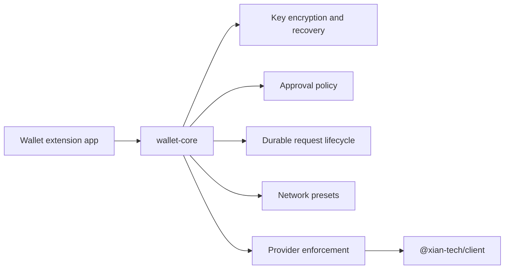

# @xian-tech/wallet-core

Reusable wallet-domain logic for Xian browser wallets.

This package lives in `xian-wallet-browser` and depends on the official
`@xian-tech/client` and `@xian-tech/provider` packages from the sibling `xian-js` repo.

It is intentionally UI-agnostic. It owns:

- wallet state models
- key encryption and recovery helpers, including BIP39-based recovery phrases
- approval rendering helpers
- the wallet controller that enforces provider permissions, approvals, durable
  request lifecycle, network-preset management, versioned external-message
  signing, and ordered transaction flow

The controller caches a network client so concurrent automatic sends share the
SDK nonce reservation manager. Prebuilt explicit-nonce transactions are
snapshots; concurrent broadcasts with the same chain, sender, and nonce are
rejected.

It does not own browser-extension transport, popup rendering, or injected-page
bridges. Those stay in app-level code such as `apps/wallet-extension/`.

## Wallet encryption and session persistence

New wallets and version-2 encrypted backups use PBKDF2-SHA256 at 600,000
iterations with AES-256-GCM. Wallets lacking stored iteration metadata use the
original 250,000 iterations. Password unlock prepares every account key,
mnemonic and shielded snapshot before replacing a legacy encrypted record.

Custom `WalletStateStore` implementations can enable migration with
`replaceState(expected, next)`, which must compare and replace atomically with
respect to ordinary saves and deletion. Return `false` if the expected record
changed. Stores without this capability keep legacy wallets readable at their
existing work factor. Ordinary writers must reject changed encryption contexts and removed records.
The controller marks explicit setup/import with `saveState(state, { replace: true })`
so a deliberate wallet replacement remains possible.

Session persistence serializes saves and deletion. Lock invalidates pending
reads and writes, so an earlier operation cannot restore an obsolete session.
